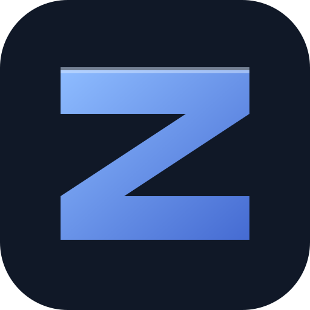
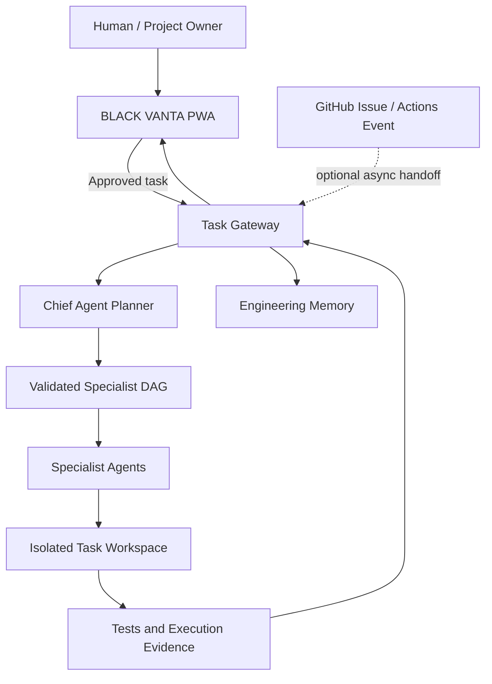

<div align="center">



# ZForge
### Zubair Autonomous Engineering Forge

**From Idea to Reality. Autonomously.**

An evidence-driven, zero-budget proof of concept for coordinating autonomous engineering agents, specialist workflows, and human-approved execution.

[](https://github.com/zopair/ZForge/actions/workflows/ci.yml)
[](https://nodejs.org/)
[](#zero-budget-engineering)
[](#proof-of-concept--enterprise-customization-readiness)

</div>

> **Start here:** [Preview guide](PREVIEW.md) · [Architecture](docs/ARCHITECTURE.md) · [Cloud execution boundaries](docs/CLOUD_EXECUTION.md)

## The business problem

Engineering teams lose time moving from an idea to a verified implementation: discovering tools, coordinating specialists, tracking execution, and proving that a task is actually complete. Autonomous workflows can help, but opaque execution and uncontrolled permissions make them difficult to trust.

## The ZForge approach

ZForge explores an evidence-driven engineering workflow: a central Chief Agent plans work, specialist agents can be coordinated through bounded dependency-aware execution, and BLACK VANTA provides the human-facing text/voice interface. Approval boundaries and completion evidence are explicit design requirements.

The current repository includes a BLACK VANTA progressive web app, a self-hostable runtime, task gateway and optional GitHub Actions cloud handoff. The cloud handoff is asynchronous and event-triggered; GitHub Pages serves only the static interface.

## Architecture at a glance



*Conceptual system view; individual integrations and deployment boundaries are documented separately.*

## Quick start

**Requirements:** Node.js 20 or newer.

```bash
git clone https://github.com/zopair/ZForge.git
cd ZForge
npm test
npm run runtime:check
npm start
```

The runtime starts locally. Configure only the local model/runtime settings needed for the capability being demonstrated. Do not expose the runtime publicly for a showcase.

- PWA entry: `index.html`
- Runtime entry: `src/runtime/server.js`
- Preview walkthrough and acceptance checks: [PREVIEW.md](PREVIEW.md)
- GitHub Pages deployment: configure **Settings → Pages → Build and deployment → Source → GitHub Actions**.

## What is implemented today

- BLACK VANTA PWA with optional self-hosted runtime connection.
- Chief Agent planning and validated specialist DAG proposals.
- Bounded, dependency-aware specialist orchestration and progress events.
- Task Gateway with task ledger, progress feed and evidence-based completion.
- Local model adapter and local-only voice integrations when host binaries/models are configured.
- Optional asynchronous GitHub Actions cloud handoff using ephemeral runners.
- Engineering memory for tool evaluation, failures and tested fixes.

**Known gaps:** persistent distributed scheduling/recovery, SBOM and provenance generation, Android release signing, iOS build workers, independent verification workers, and production deployment automation remain incomplete. The host process runner is not an OS/container security boundary; see [Execution Runtime Contract](docs/EXECUTION_RUNTIME_CONTRACT.md).

## Zero-budget engineering

- Prefer free, client-side, self-hosted, and GitHub-native infrastructure.
- Use open-source dependencies only after checking the actual license, maintenance signals, security posture, and supply-chain red flags.
- No paid API, subscription, credit-based service, or commercial SaaS is required for the basic local preview.
- Keep CI focused on fast, deterministic checks. Expensive browser-engine checks are opt-in and are not part of the normal quality gate.
- Treat external integrations and cloud execution as optional capabilities, not prerequisites for the core demonstration.

## Proof of Concept & Enterprise Customization Readiness

ZForge is a **Proof of Concept / MVP intended for technical evaluation, partner demonstrations, and investment discussions**. It is not represented as a production-certified enterprise platform.

The current baseline demonstrates the shape of an extensible engineering workflow. Enterprise adaptation can be scoped later around a customer's identity provider, policy model, approved model/runtime, execution environment, audit requirements, integrations, and operational controls. Those integrations require customer-specific discovery, funding, and validation; they are not implied to exist today.

### Development record

- **Preview-readiness baseline:** reproducible setup instructions, a bounded reviewer walkthrough, acceptance criteria, and explicit known limitations.
- **Resource-aware CI:** dependency-free unit tests and syntax checks run by default; multi-browser smoke testing is an optional manual action.
- **Evidence-first status:** implementation claims are scoped to the code paths and checks actually available in this repository.

## Documentation map

| Area | Reference |
|---|---|
| System architecture | [ARCHITECTURE.md](docs/ARCHITECTURE.md) |
| Preview steps and acceptance | [PREVIEW.md](PREVIEW.md) |
| Cloud execution | [CLOUD_EXECUTION.md](docs/CLOUD_EXECUTION.md) |
| Runtime security boundary | [EXECUTION_RUNTIME_CONTRACT.md](docs/EXECUTION_RUNTIME_CONTRACT.md) |
| Task Gateway | [TASK_GATEWAY.md](docs/TASK_GATEWAY.md) |
| Agent Factory | [AGENT_FACTORY.md](docs/AGENT_FACTORY.md) |
| Chief Agent orchestration | [CHIEF_AGENT_ORCHESTRATION.md](docs/CHIEF_AGENT_ORCHESTRATION.md) |
| Browser QA (optional) | [BROWSER_QA.md](docs/BROWSER_QA.md) |
| Daily research brief | [DAILY_BRIEF.md](DAILY_BRIEF.md) |

## CI policy

Every normal push and pull request runs the lightweight quality gate: `npm test`, JavaScript syntax checks for cloud entrypoints, and Python syntax validation for the offline KemeTone adapter.

The multi-browser smoke job is **manual and opt-in** from GitHub Actions → **ZForge Quality Gate** → **Run workflow** → enable `run_browser_smoke`. It installs Chromium only. Firefox and WebKit are intentionally excluded from the zero-budget preview gate.

## Intellectual Property & Authorship

**Founder & Developer:** **Aly Hussein Zopair (علي حسين زوبير)**.

The project identity, original architecture, documentation, and project-authored source contributions are attributed to the named founder/developer, subject to the provenance and third-party notices of individual components and dependencies.

**Rights notice:** All rights in original project materials are reserved by the author unless a separate written license or permission explicitly states otherwise. No open-source license grant should be inferred from public repository visibility alone. Third-party components remain governed by their respective licenses. A repository-level license file should be added only after the intended distribution terms are formally selected.

---

<p align="center"><sub>ZForge · Evidence-driven autonomous engineering · Proof of Concept / MVP</sub></p>
